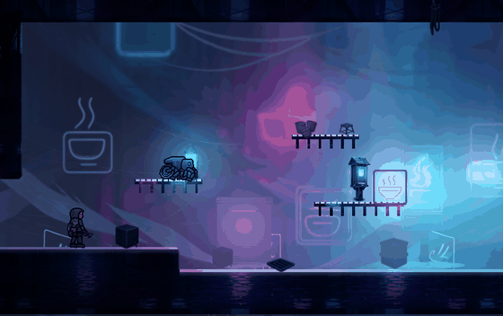
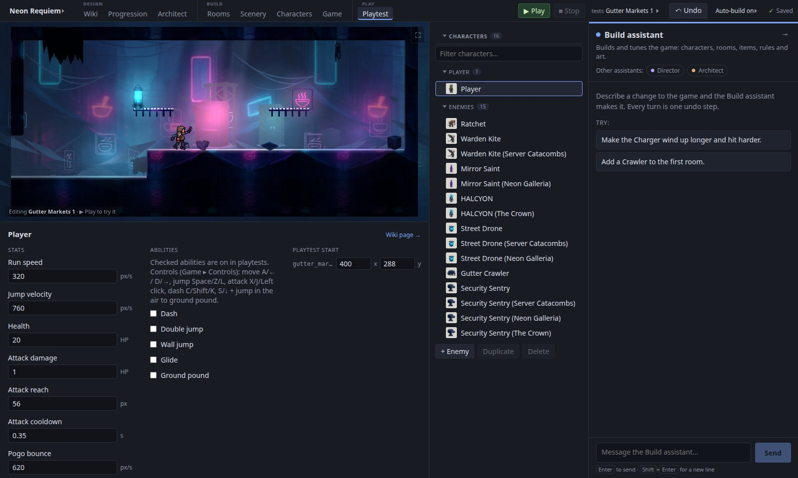
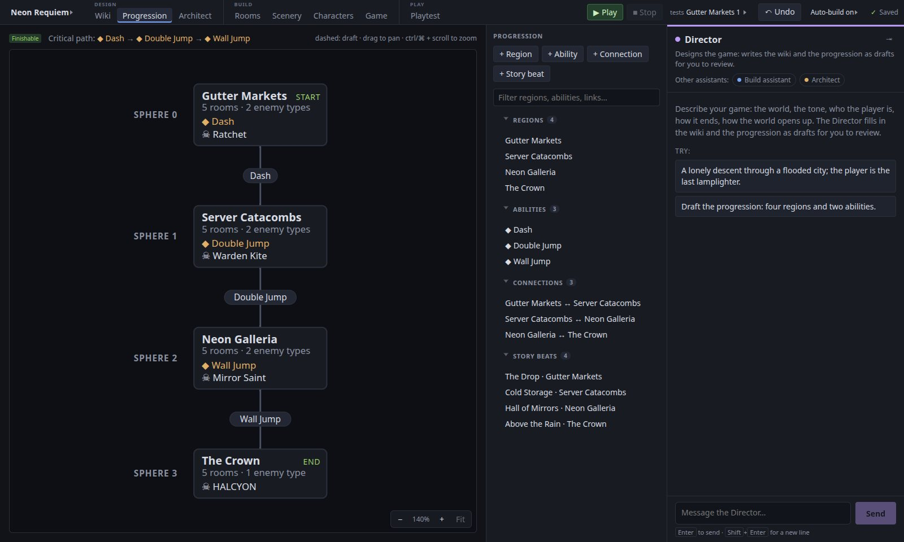
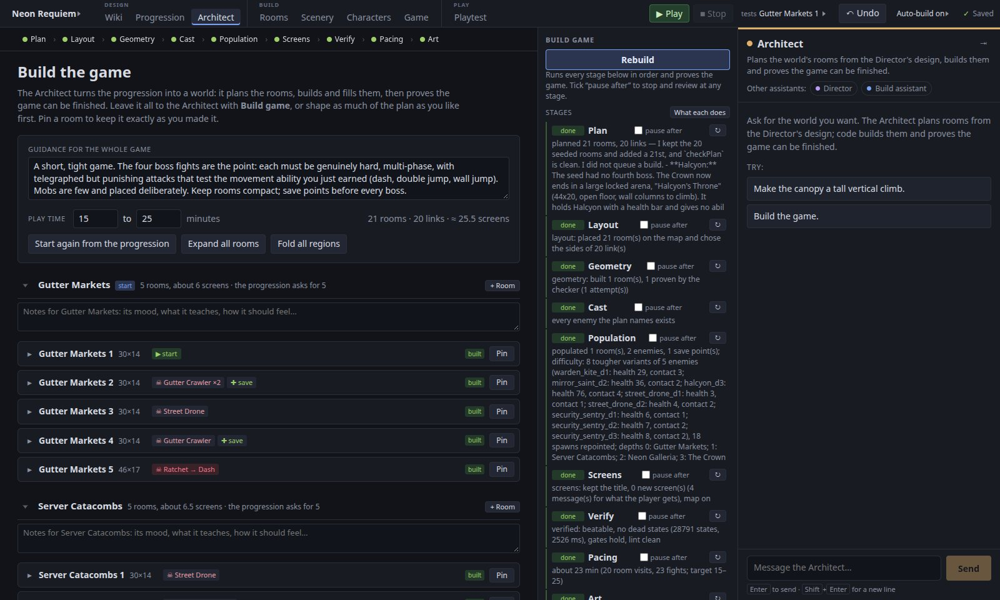
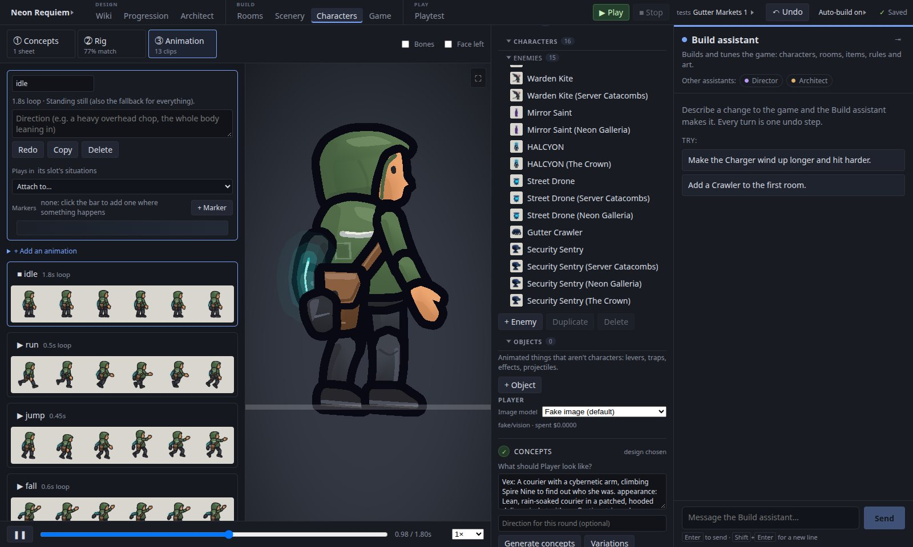
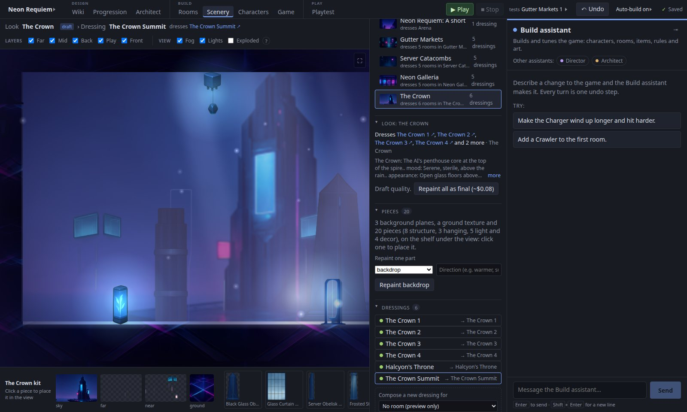
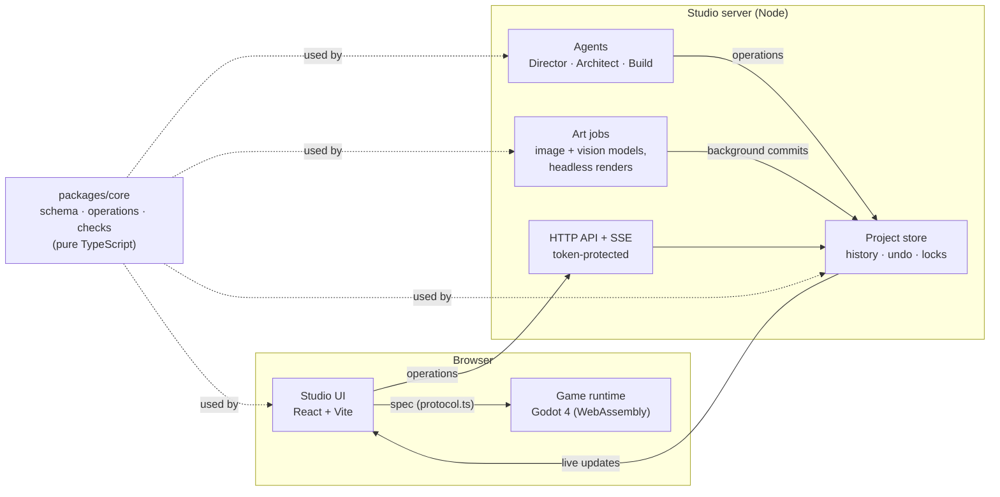

# Anomaly

**An AI-native studio for making 2D action-platformers.** Describe the game you want; AI agents
write its story and structure, plan and build its levels, draw and animate its characters, and the
studio *proves the game can be finished* before you ship it as a standalone web game.

[](https://github.com/armmahajan/game-engine/actions/workflows/ci.yml)


<p align="center">
  
  <br>
  <sub>A playtest of <em>Neon Requiem</em>, a game made in the studio. Levels, enemies, behaviours, character rigs, animation and scenery were all generated in the studio.</sub>
</p>



## What it does

1. **Design.** A *Director* agent turns a pitch into a game bible (wiki pages for characters,
   places and lore) and a **progression graph**: regions, abilities, gates and story beats. The
   graph is checked like a randomizer's logic: sphere by sphere, it finds the critical path and
   flags soft-locks and unobtainable abilities.
2. **Build.** The *Architect* turns the progression into a world. It plans rooms, lays them out on
   a map, generates their tile geometry (each room proven traversable with the player's real
   physics), places enemies and save points, and paces the run to a target play time.
3. **Art.** An art pipeline generates concept sheets, turns the chosen design into a **bone rig**
   (layered meshes, IK, spring bones), animates it clip by clip, and dresses each region with
   parallax scenery, props and lighting.
4. **Play and tune.** The game runs live in a Godot runtime embedded in the studio. A *Build
   assistant* edits enemies, behaviours, rooms and rules from plain language, and every change
   is one undo step.
5. **Ship.** A static solver proves the whole game is beatable with no dead ends, then the
   studio exports a self-contained web build (byte-for-byte reproducible) to host anywhere.

<table>
  <tr>
    <td></td>
    <td></td>
  </tr>
  <tr>
    <td align="center"><sub><b>Progression</b>: regions by sphere, gates and the critical path</sub></td>
    <td align="center"><sub><b>Architect</b>: plan → layout → geometry → population → verify → pacing → art</sub></td>
  </tr>
  <tr>
    <td></td>
    <td></td>
  </tr>
  <tr>
    <td align="center"><sub><b>Characters</b>: concept → rig → animation clips</sub></td>
    <td align="center"><sub><b>Scenery</b>: parallax layers, fog, lights and a kit of placeable pieces</sub></td>
  </tr>
</table>

## Engineering highlights

- **One validated source of truth.** The whole game is a single typed project spec
  ([Zod](https://zod.dev) schemas in `packages/core`). It changes only through pure
  operations that take untrusted input and return `{ ok, project } | { ok: false, error }`. The UI,
  HTTP API, scripts and AI agents all use the same operations, so every edit is validated,
  attributed (`user` / `ai`), versioned, undoable and pushed live to every open studio.
- **Optimistic concurrency.** Edits name the revision they were based on and are rejected as
  `stale_revision` rather than silently overwriting. Background work (art jobs, live generation)
  commits through a separate path that rebases onto whatever the project is at that moment.
  Schema changes ship with migrations.
- **A data-driven Godot runtime.** The game has no hand-authored scenes: the runtime builds
  everything from the spec it's sent over a small protocol that speaks project terms, not
  engine terms. Enemy AI is data too: state machines composed from 30+ small action and
  condition primitives (patrol, charge, telegraph, teleport, `canSeePlayer`, `healthBelow`…).
- **Physics mirrored in two languages.** Player movement is custom box-vs-rectangle code in
  GDScript, mirrored line for line in TypeScript. Tests drive both with the same inputs and require
  them to agree to **0.001 px**. A movement model built on that simulation searches jump, dash
  and glide timings to compute exactly what the player can reach, and level generation and
  checking rely on it.
- **Proving a game is beatable.** `checkGame` runs a deterministic breadth-first search over
  game states (room, position, flags, items, abilities, checkpoints, saves, open dialogs). It
  reports every dead end with the shortest way into it and a readable explanation, e.g. *"stuck in
  pit: the way out of pit needs double_jump"*. The game-logic interpreter it uses is itself mirrored
  against the runtime by tests. A 30-room game checks in about a second.
- **Procedural generation with guarantees.** The Architect's geometry stage composes rooms from
  blocks sized to the movement model, then proves each one with the runtime's physics. Every exit
  must be reachable, every gated door must open with exactly its required abilities, and the room
  must have no traps or unstandable platforms. Plans are fingerprinted so only stale stages rerun,
  and rooms you pin are kept exactly as you made them.
- **Agents with guardrails.** Agent tools are generated from the core schemas, so the model sees
  the same contracts the code enforces. A turn stages its writes on a draft and commits them as
  **one atomic batch**, and a failed or cancelled turn saves nothing. The Director's drafts never
  overwrite the creator's canon unless asked to.
- **Natural motion in a 2D rig runtime:** two-bone IK, spring bones on fixed 120 Hz substeps,
  crossfades between clips, easing curves and per-part looks (tint, glow, opacity).
- **Tested at every layer:** 1,000+ unit tests (Vitest), headless Godot simulations at a fixed 60 fps
  that assert positions and states frame by frame, and 77 Playwright end-to-end tests that drive the
  real studio and runtime with scripted AI and art backends, so nothing costs money.

## Architecture



| Path | What lives there |
|---|---|
| `packages/core` | The project schema, every operation, undo, migrations, progression and game checks, the Architect's stages, the movement model, the runtime protocol. Pure TypeScript, no I/O. |
| `packages/server` | Project store (disk, append-only history, undo, locking), the HTTP API, live generation, art jobs, game export. Mounted in Vite. |
| `packages/agent` | The AI agents: schema-generated tools, the turn loop, Claude Agent SDK and OpenAI-style backends, a scripted fake model for tests. |
| `packages/art` | The art pipeline: image and vision clients, prompts, concept → rig → animation stages. |
| `apps/studio` | The React workspace. Mirrors the server's project and drives the runtime. |
| `game/` | The Godot project: runtime, behaviour primitives (one small file each), headless test probes. |
| `e2e/` | Playwright tests against the real studio and runtime. |

## Tech stack

TypeScript (strict) · React 19 · Vite · Node · Zod · Godot 4.7 / GDScript (web export) ·
Claude Agent SDK · OpenRouter (image and vision models) · Vitest · Playwright

## Running it locally

**Prerequisites:** Node 24+, and Godot 4.7 with web export templates (`godot` on your `PATH`, or
set `GODOT=/path/to/godot`).

```sh
npm install
npm run dev        # exports the Godot runtime on first run, then serves http://localhost:5173
```

The dev server prints a link with an access token (`?token=…`). Open it once and the browser keeps
a cookie. Project data is saved under `projects/default/`.

**AI features** are optional; the editor, runtime and checks work without them:

- *Chat agents* use your local [Claude Code](https://claude.com/claude-code) login through the
  Claude Agent SDK.
- *Art generation* needs an [OpenRouter](https://openrouter.ai) key. Copy `.env.example` to `.env`
  and set `OPENROUTER_API_KEY`. A full character costs about $0.01–0.02, and every job has a
  budget cap.
- To try everything offline, set `STUDIO_CHAT_BACKEND=fake STUDIO_ART_BACKEND=fake` for scripted
  models. These are the ones the end-to-end tests use.

**Controls:** A/D or arrows to move, Space to jump, X to attack (hold Up to swing up, Down in the
air to pogo). With abilities enabled: C to dash, jump again in mid-air, slide down and jump off walls,
hold jump to glide. All keys can be rebound in Game ▸ Controls.

## Tests

| Command | What it runs |
|---|---|
| `npm run typecheck` | TypeScript across every package |
| `npm test` | Unit tests, plus headless Godot tests (`game/test`; needs `godot` on `PATH`) |
| `npm run e2e` | Playwright tests against the real studio and runtime on its own port, with a throwaway project |

## Documentation

[`docs/reference.md`](docs/reference.md) is the full technical reference: the HTTP API and every
operation, the agents, the live pipeline, the progression and game checks, rooms and game logic,
export, controls, weapons, animation and the art pipeline.

## License

Copyright © 2026. All rights reserved. The source is published for viewing; see [LICENSE](LICENSE).
